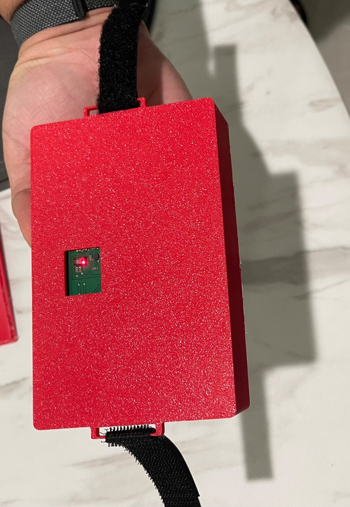
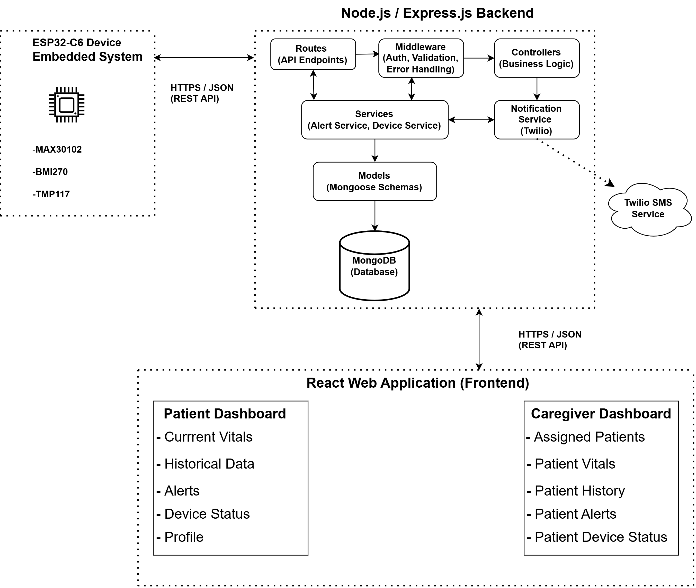
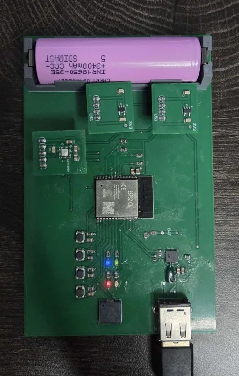
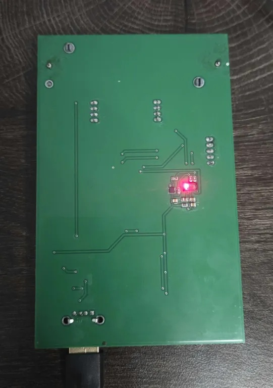
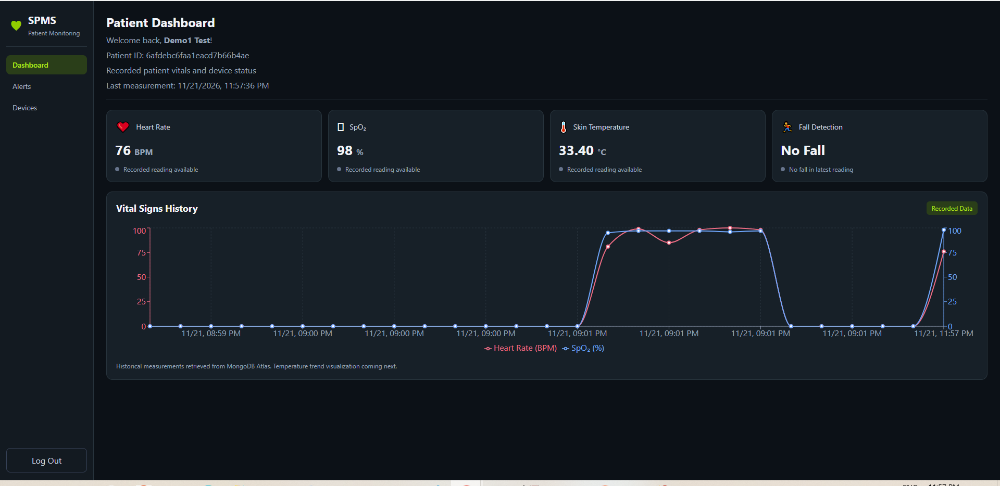
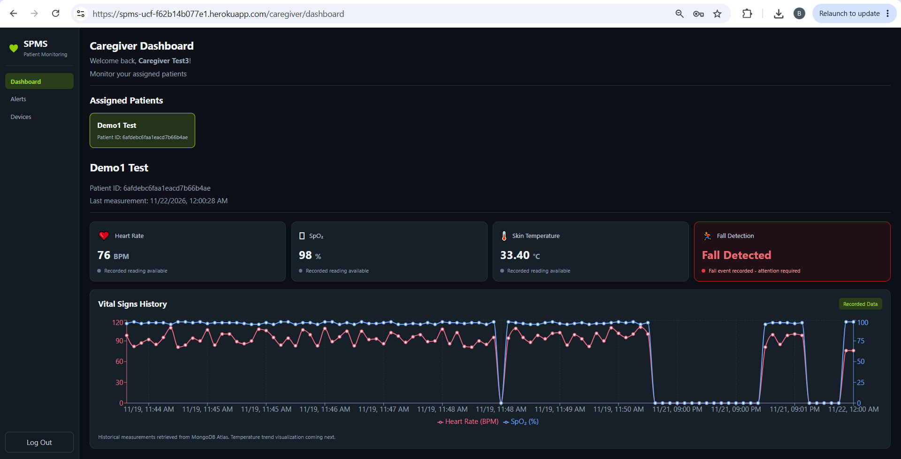
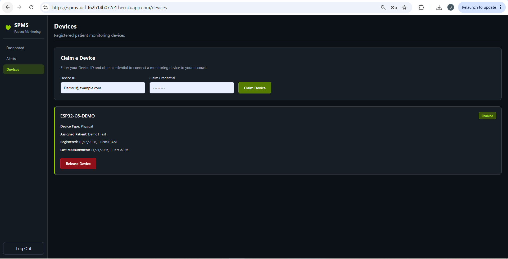
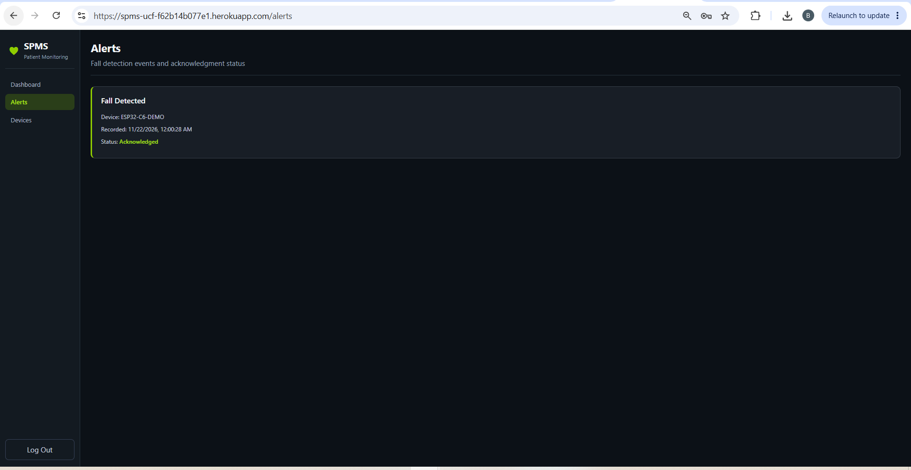

# Smart Patient Monitoring System for the Elderly

**University of Central Florida · Senior Design Group 10 · Fall 2026**

An IoT-based wearable monitoring prototype that collects physiological measurements, transmits them to a cloud-connected backend, and presents patient information through role-specific React dashboards. The system also records fall-detection and emergency events for caregiver review.

> **Project status:** Senior Design II final demonstration completed (November 2026). Educational prototype; not a certified medical device.

## Live Application and Project Resources

- **[Live React Web Application (Heroku)](https://spms-ucf-f62b14b077e1.herokuapp.com/login)** — deployed patient and caregiver application (login required).

## Project at a Glance

The system combines a custom wearable PCB and enclosure with an ESP32-C6, physiological sensors, Wi-Fi networking, a Node.js/Express REST API, MongoDB Atlas, and a React/Vite frontend.

Measurements and events include:

- Heart rate (BPM)
- Blood oxygen saturation (SpO₂)
- Skin temperature (°C)
- Fall-detection events
- SOS/emergency-event indicators
- Device association and recent measurement status

### Assembled Wearable Prototype




*Figure 1. Custom wearable enclosure with adjustable straps and a visible status indicator.*

## System Architecture



*Figure 2. Embedded device, backend services, database, and React web application.*

### End-to-End Data Flow

1. Sensors attached to the ESP32-C6 capture physiological and motion readings.
2. ESP-IDF firmware packages readings into JSON and sends them over Wi-Fi to the backend REST API.
3. The Node.js/Express backend authenticates device requests, validates measurements, and stores data in MongoDB Atlas.
4. Authenticated patients and caregivers retrieve authorized data through REST endpoints.
5. React dashboards display the latest readings, historical charts, device information, and recorded emergency events.
6. Fall or SOS events create alert records; Twilio can send caregiver SMS notifications when enabled.

**Communication terminology:** Sensors use **I²C**. The wearable communicates with the backend using **HTTP/HTTPS REST**, with **JSON** as the payload format. HTTPS applies where TLS is configured; JSON is not a hardware interface.

## Hardware

| Component | Purpose | Interface |
| --- | --- | --- |
| ESP32-C6 | Main microcontroller and wireless networking | Wi-Fi, I²C |
| MAX30102 | Heart-rate and SpO₂ sensing | I²C |
| TMP117 | Skin-temperature sensing | I²C |
| MPU6050 | Motion sensing for fall detection | I²C |
| Custom PCB | Integrates MCU, sensors, controls, power circuitry, and indicators | On-board circuitry |
| Battery and enclosure | Portable wearable form factor | Power / mechanical |

The final presentation identifies the **MPU6050** as the motion sensor used in the prototype, replacing the earlier BMI270 design consideration.

### PCB — Front View



*Figure 3. Populated PCB showing the ESP32-C6, battery, buttons, and indicators.*

### PCB — Back View



*Figure 4. Reverse side of the custom PCB with a visible illuminated indicator.*

## Software Stack

| Layer | Technology |
| --- | --- |
| Firmware | Embedded C, ESP-IDF, PlatformIO |
| Microcontroller | ESP32-C6 |
| Sensor bus | I²C |
| Network and API | Wi-Fi, HTTP/HTTPS, REST, JSON |
| Backend | Node.js, Express.js |
| Database | MongoDB Atlas, Mongoose |
| Authentication | JWT, bcrypt; device API-key authentication |
| Frontend | React, Vite, JavaScript, React Router |
| HTTP client | Axios |
| Notifications | Twilio service integration |
| Testing and source control | Postman, Git, GitHub |
| Hosting | Heroku (web application) |

## React Web Application

The deployed web application uses role-based interfaces for patients and caregivers. It retrieves readings from the Express backend using REST requests, with periodic polling rather than WebSockets.

### Patient Dashboard

- Latest heart rate, SpO₂, and skin-temperature readings
- Fall-detection status
- Historical heart-rate and SpO₂ chart
- Navigation to alerts and device management
- Latest recorded measurement timestamp



*Figure 5. Patient view with current vital-sign cards and historical readings.*

### Caregiver Dashboard

- Assigned-patient selection
- Patient-specific latest measurements and history
- Fall-detection status prominently displayed
- Access to device and alert information



*Figure 6. Caregiver view displaying an assigned patient, historical readings, and a recorded fall event.*

### Device Management

- Claim a registered device using its ID and claim credential
- Review device type, assigned patient, registration date, and last measurement
- Release an associated device



*Figure 7. Device claiming and registered-device details.*

### Alerts and Acknowledgment

The alerts interface lists recorded fall events, their device association and timestamp, and acknowledgment status.



*Figure 8. Recorded fall event displayed with acknowledged status.*

### Authentication and Data Refresh

- Patient and caregiver accounts use JWT-backed authentication.
- Protected frontend routes and backend authorization restrict access by role.
- Axios handles frontend requests to REST endpoints.
- Dashboards use periodic polling (approximately five seconds) to refresh monitoring information.
- Historical chart data is retrieved from MongoDB-backed API responses.

> **Prototype note:** The screenshots include test/demo measurements. The historical charts currently show heart rate and SpO₂; temperature trend visualization is not yet shown. Zero-value demo readings can create sharp transitions in the plots.

## Backend and Database

The Express backend handles user authentication, device identity and assignment, incoming vitals, history retrieval, and alerts. MongoDB Atlas provides persistent storage through Mongoose models.

### Backend Route Modules

The application organizes its principal user-facing routes into five files:

| Route file | Responsibility |
| --- | --- |
| `authRoutes.js` | User registration and login |
| `patientsRoutes.js` | Patient-specific vital-sign history |
| `caregiverRoutes.js` | Assigned patients and caregiver-authorized vital-sign history |
| `deviceRoutes.js` | Device listing, claiming, and release |
| `alertRoutes.js` | Alert retrieval and acknowledgment |

Vitals ingestion and the health check are also exposed by the backend. **Five route files does not mean five API endpoints.**

### Confirmed REST API Endpoints

The following **13 endpoints** were verified during the project review. The health check is included in the count.

| Method | Endpoint | Purpose | Authentication |
| --- | --- | --- | --- |
| `GET` | `/api/v1/health` | Check backend health | Public |
| `POST` | `/api/v1/auth/register` | Register a user | Public |
| `POST` | `/api/v1/auth/login` | Authenticate a user | Public |
| `POST` | `/api/v1/vitals` | Submit wearable measurements | Device API key |
| `GET` | `/api/v1/patients/me/vitals` | Retrieve the authenticated patient's vitals | JWT |
| `GET` | `/api/v1/caregivers/me/patients` | Retrieve patients assigned to the caregiver | JWT |
| `GET` | `/api/v1/caregivers/me/patients/:patientId/vitals` | Retrieve vitals for an assigned patient | JWT |
| `POST` | `/api/v1/devices/claim` | Claim a device | JWT |
| `POST` | `/api/v1/devices/:deviceId/release` | Release a device | JWT |
| `GET` | `/api/v1/devices` | Retrieve devices | JWT |
| `GET` | `/api/v1/alerts` | Retrieve authorized alerts | JWT |
| `GET` | `/api/v1/alerts/:id` | Retrieve a specific authorized alert | JWT |
| `PATCH` | `/api/v1/alerts/:id/acknowledge` | Acknowledge an alert | JWT |

Patient and caregiver access is authorization-scoped. All three alert routes require JWT authentication; alert access is restricted to authorized users.

### Authenticated Vitals Ingestion and Emergency Notifications

When the ESP32-C6 submits a reading to `POST /api/v1/vitals`, the backend:

1. Authenticates the device and uses `req.device` to identify the device and its assigned patient.
2. Rejects readings from devices that are not assigned to a patient.
3. Validates and saves the vital-sign measurement in MongoDB Atlas.
4. Creates a database alert when `fallDetected` or `sosTriggered` is true.
5. Sends caregiver SMS notifications **when `SMS_ENABLED=true`** and the notification service is configured.
6. Returns **HTTP `201 Created`** after successfully saving the reading.

Device and patient identifiers are derived from the authenticated device association rather than trusting arbitrary identifiers in the incoming JSON. SMS delivery is conditional on configuration and is not a guaranteed emergency service.

### Vitals Schema

| Field | Type | Validation / meaning |
| --- | --- | --- |
| `deviceId` | String | Required device identifier |
| `patientId` | ObjectId | Required reference to a user |
| `timestamp` | Date | Required measurement time |
| `heartRateBpm` | Number | Required, minimum 0 |
| `spo2Percent` | Number | Required, range 0–100 |
| `skinTemperatureC` | Number | Required |
| `fallDetected` | Boolean | Defaults to `false` |
| `sosTriggered` | Boolean | Defaults to `false` |
| `createdAt`, `updatedAt` | Date | Automatically maintained by Mongoose |

**Example stored vitals data** (illustrative values; this is not necessarily the exact device request body):

```json
{
  "deviceId": "ESP32-C6-DEMO",
  "patientId": "507f1f77bcf86cd799439011",
  "timestamp": "2026-11-21T23:57:36Z",
  "heartRateBpm": 76,
  "spo2Percent": 98,
  "skinTemperatureC": 33.40,
  "fallDetected": false,
  "sosTriggered": false
}
```

The `deviceId` and `patientId` fields above describe **stored records**. The authenticated ingestion controller resolves these values from `req.device`; this example is not a specification for the exact ESP32 HTTP request body.

## Embedded Firmware

The ESP32-C6 firmware uses ESP-IDF and embedded C to communicate with sensors, assemble JSON readings using cJSON, establish Wi-Fi connectivity, and submit readings to the backend. Serial output and backend responses were used to validate successful ingestion. The backend uses device API-key authentication for incoming readings. JSON is the payload format; HTTP/HTTPS is the application protocol (HTTPS only where TLS is configured).

## Testing and Demonstration

Testing and integration activities included:

- Postman checks for registration, authentication, and API response codes
- MongoDB Atlas verification of stored records
- ESP32-C6 serial output showing HTTP submission and response
- End-to-end device-to-backend data transmission
- Patient and caregiver dashboard rendering of stored measurements
- Device claiming and release interface testing
- Recorded fall-event and acknowledgment interface demonstration
- Validation of assigned-device checks and the HTTP `201 Created` ingestion response
- Review of conditional Twilio SMS notification handling

The system is a **Senior Design prototype**. The presence of alert and notification code does not constitute validation of medical-grade accuracy, emergency delivery guarantees, or clinical reliability.

## Team and Work Distribution

The project was completed by **three students** in UCF Senior Design Group 10. Responsibilities below reflect the team's final presentation and the implemented software work.

| Member | Discipline | Primary responsibilities |
| --- | --- | --- |
| **Braedon Dudley** | Electrical Engineering | PCB design, embedded design, design documentation, PCB soldering |
| **Bryan Perez** | Computer Engineering | Backend design, React frontend and project website, database/API integration, authentication, SMS integration |
| **Daniel Delgado** | Electrical Engineering | PCB soldering and design, firmware design, schematics, embedded design | 

### Bryan Perez — Software Lead / Full-Stack Development

- Designed and implemented the Node.js/Express backend and MongoDB/Mongoose data layer.
- Developed authentication, authorization, vitals APIs, device-management flows, and alert-related backend functionality.
- Built the React/Vite patient and caregiver dashboards, reusable vital-sign visualizations, and REST API integration.
- Implemented protected navigation, device claiming/release interfaces, and periodic data refresh.
- Supported firmware/backend integration, API testing, architecture documentation, and the UCF project website.
- Conducted end-to-end testing of ESP32-C6 vital-sign transmission, REST API processing, MongoDB data persistence, and real-time dashboard visualization.

## Repository Layout

```text
smart-patient-monitoring-system/
├── backend/             # Express API, models, routes, middleware
├── frontend/            # React/Vite web application
├── firmware/            # ESP32-C6 embedded software
├── docs/
│   └── images/          # Architecture, hardware photos, UI screenshots
└── README.md
```

*Directory view is simplified for readability.*

## Disclaimer

This is an educational engineering prototype and is **not** an FDA-cleared medical device. It is not intended for clinical diagnosis, treatment decisions, or guaranteed emergency response. Physiological measurements and emergency-event detection require further validation before real-world medical use.
